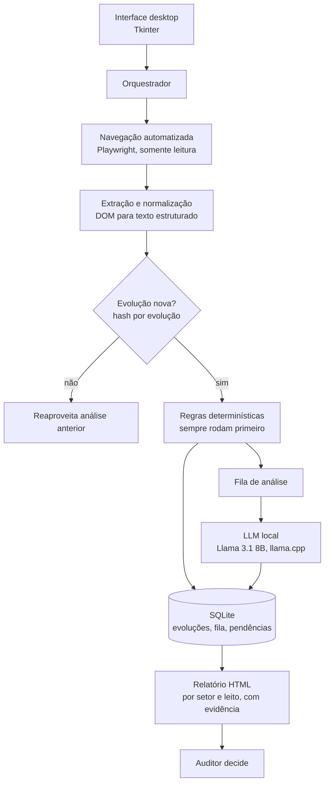

# GSUS Auditoria: assistente de auditoria hospitalar com LLM local

> **English summary.** Desktop assistant used daily by a hospital auditor in a public hospital.
> It reads each inpatient's electronic record in read-only mode, applies deterministic rules for
> objective findings, and sends only free-text clinical notes to a local LLM (Llama 3.1 8B on
> llama.cpp) to flag what is blocking discharge. Everything runs on-premise: no cloud, no external
> API, no patient text leaves the hospital. Every flag comes with the source sentence that
> supports it, and the auditor always makes the decision. **The source code is private; this
> repository is an overview of the architecture and the engineering decisions.**

Este repositório é a visão geral de um sistema em uso. O código é privado porque opera dentro de
um hospital público, sobre um sistema de prontuário eletrônico.

O projeto nasceu do mestrado profissional do pesquisador Matheus Henrique Amida Beltrame
(UEM / GETS). Eu atuo no desenvolvimento técnico do sistema.

## O problema

Auditoria concorrente de leito é abrir o prontuário de um paciente, ler a evolução, checar se o
resultado do exame saiu, anotar, fechar e repetir para o próximo. Num hospital com 150 a 200
pacientes internados, isso ocupa o dia inteiro de um auditor. No dia seguinte quase tudo se
repete, porque a maioria continua internada.

O sistema de prontuário não tem exportação consolidada do estado dos leitos. Cada informação vive
dentro do prontuário individual. Por isso um exame pedido há quatro dias sem resultado, ou uma
interconsulta sem retorno, só aparece quando alguém tem tempo de abrir aquele prontuário.

## O que o sistema faz

- Lista os pacientes internados no setor configurado e abre o prontuário de cada um, com uma
  credencial que só tem permissão de leitura.
- Extrai as evoluções em texto e processa só o que é novo desde a última execução.
- Aplica regras determinísticas para pendências objetivas (exame sem resultado, interconsulta
  sem parecer).
- Envia para um modelo de linguagem local apenas o texto livre que precisa de interpretação.
- Gera um relatório por setor e leito: o que está pendente, o trecho da evolução que sustenta
  cada item e há quanto tempo está parado.
- Resume o caso a partir da evolução médica (necessidade hospitalar, objetivo terapêutico,
  próximo passo), sempre apontando a fonte.
- Acompanha cada pendência até o fim. O sistema só encerra uma pendência sozinho quando a
  evolução traz prova posterior ao pedido; na dúvida, ela fica em verificação para o auditor.
- Roda em horário agendado e também sob demanda, com um clique.

**Em uso no dia a dia pelo auditor, economizando horas de leitura manual de prontuários.**

## Arquitetura

O aplicativo é um único executável Windows com instalador. Ele orquestra dois processos locais:
o navegador automatizado e o servidor do modelo. Depois de instalado, não precisa de internet.

## Decisões de engenharia

- **Regras primeiro, LLM depois.** O que é objetivo é resolvido por código, que é rápido,
  barato e previsível. O modelo só recebe o texto livre que exige interpretação.
- **Resposta ancorada em evidência.** Toda pendência vem com o trecho da evolução que a
  sustenta. O sistema nunca afirma que "o paciente parece aguardar algo" sem mostrar onde isso
  está escrito.
- **Humano decide.** O relatório aponta evidência, não conduta. O sistema não decide alta nem
  prioridade. Cada decisão do auditor fica em um histórico que só recebe acréscimos.
- **Somente leitura.** Em nenhum ponto o sistema escreve, prescreve ou altera algo no prontuário.
- **Tudo on-premise.** O modelo roda na máquina do hospital. Nenhum texto de prontuário sai da
  instituição.
- **Minimização de dados.** O sistema não guarda nome de paciente, só prontuário, leito e
  unidade, pseudonimizados onde o dado bruto não é necessário.
- **Processamento incremental.** Um hash por evolução evita reler o histórico inteiro a cada
  execução.
- **Extração e inferência em paralelo.** A leitura dos prontuários é limitada pela velocidade do
  sistema de origem; a inferência é lenta porque roda em CPU. Assim que um prontuário termina de
  ser lido ele entra na fila de análise, enquanto a navegação segue para o próximo. Antes disso o
  modelo ficava mais de uma hora ocioso esperando a extração de um censo de cem pacientes.
- **Falha isolada.** Um prontuário com erro de extração fica marcado no relatório e o resto do
  lote segue.

## Validação

A pesquisa que originou o projeto mede a concordância do sistema com auditores especialistas do
próprio hospital pelo índice Kappa de Cohen, com meta de 0,80. Quem decide se a ferramenta está
pronta é a revisão humana caso a caso, não uma métrica que o sistema reporta sobre si mesmo.

## Stack

Python, Playwright, llama.cpp (Llama 3.1 8B, GGUF), SQLite, Tkinter, pytest, instalador Windows
(Inno Setup).

## Contato

Felipe Nantes · [linkedin.com/in/felipe-nantes-23719b349](https://www.linkedin.com/in/felipe-nantes-23719b349/) ·
[github.com/felipe-nantes](https://github.com/felipe-nantes)
